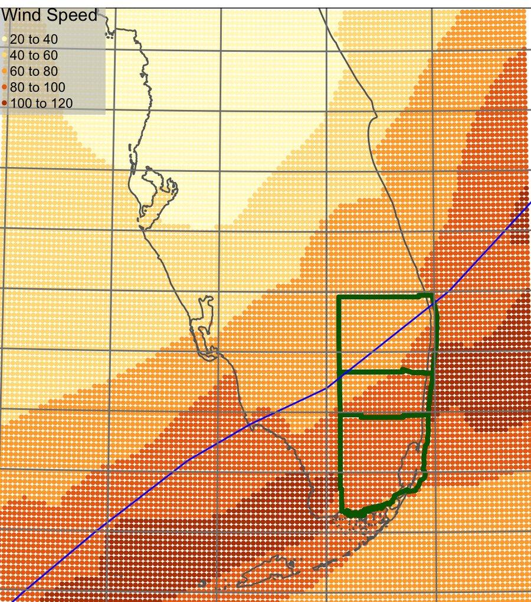

**Role:** PhD candidate, sole author | **Completed:** May 2024 | **Advisor:** Renato Molina | **Committee:** Katharine Mach, David Kelly, Chris Parmeter

## Overview

My dissertation, *Essays on Housing Affordability and Climate Risk in Florida*, asks how hurricanes and flood risk change Florida's housing market. Each chapter looks at a different part of that market: home sales, rentals, and mobile homes. Together they show that climate events can make housing less affordable, and that the costs fall hardest on lower-income households.

## Chapter 1: Hurricane Wilma and affordable housing

This chapter looks at home and condo sales in Palm Beach, Broward, and Miami-Dade counties after Hurricane Wilma in 2005. I used a two-way fixed effects model to link each sale to the wind speed it was exposed to.

- Each 1 mph increase in wind speed lowered the affordability of a sale by 0.42 points.
- Each 1 mph increase also cut the chance that a sale was affordable for a median-income household by 0.6%.
- At the top of the wind range, 97 mph, a home was 14% less likely to sell at an affordable level.
- The effects were largest in the highest wind bins.

## Chapter 2: Hurricane Irma and rental housing

This chapter looks at asking rents across Florida after Hurricane Irma in 2017. I used a difference-in-differences design on weekly rental listings from 2014 to 2019.

- Units exposed to hurricane-force winds (above 73 mph) saw rents rise by about $64 a month.
- Most of the increase came 12 to 24 months after landfall. This points to a temporary jump in rental demand after the storm.
- Landlords of exposed single-family rentals were also more likely to sell, which reduced rental supply.

## Chapter 3: Mobile homes and climate risk

This chapter measures how exposed Florida's mobile homes are to flood zones and storm surge. It compares homes in mobile home parks with privately owned mobile homes, and it accounts for the building code era each home was built in.

- Neighborhoods with the most exposed mobile homes tend to be older and have lower incomes than Florida on average.
- Mobile home park residents face higher climate risk than private owners. They are more exposed and more socially vulnerable.
- The chapter ends with recommendations for residents, emergency managers, and land use planners, including cooperative insurance options for resident-owned communities.

## Related work

During my PhD I also worked on other climate risk and housing research at the University of Miami. These papers are listed on my [Publications](/publications/) page.
