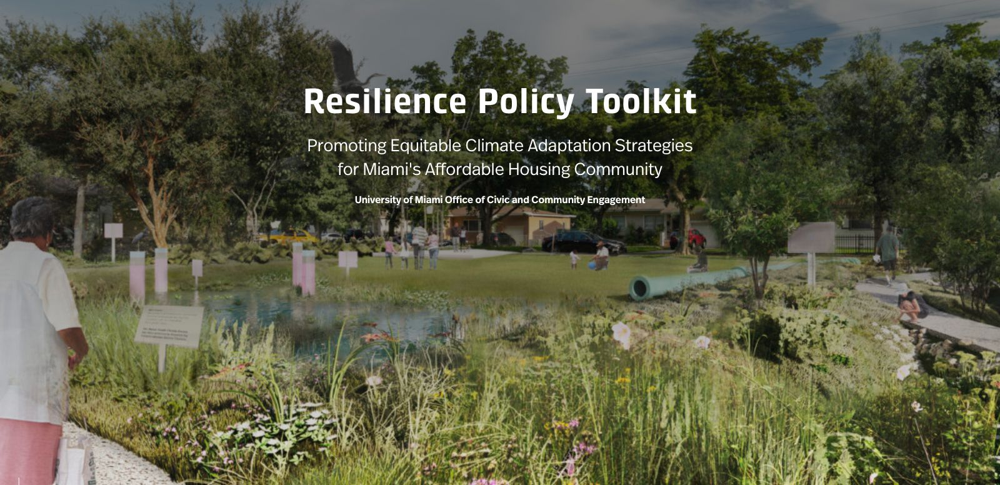

**Role:** Research Assistant, led toolkit development | **Dates:** January 2020 – January 2021

## Overview

The University of Miami's Office of Civic and Community Engagement partnered with Miami-Dade County municipalities on affordable housing and climate resilience. I led development of the Resilience Policy Toolkit. It is a guide for cities on nature-based solutions that reduce climate risk in vulnerable coastal neighborhoods.

## What the toolkit covers

| Solution | Hazard it addresses |
|---|---|
| Retention-pond parks | Flooding and stormwater |
| Urban tree canopy | Extreme heat |
| Natural coastal barriers (mangroves, dunes, reefs) | Hurricane and storm-surge impacts |

## My contributions

- Led development of the toolkit. I synthesized peer-reviewed research and municipal best practices into guidance for each solution.
- Supported the toolkit's adaptation cost-benefit analysis, which compared four building types across seven Miami neighborhoods.
- Contributed the flood zone, storm surge, and sea-level-rise layers to the Miami Affordability Project, an interactive map of affordable housing need built by the University's Institute for Data Science and Computing.

## Impact

The toolkit and map were delivered to the City of Miami and used in its housing and resilience policy work. They were part of a wider body of University of Miami work that helped cities and the county bring nature-based resilience projects to vulnerable coastal communities.
