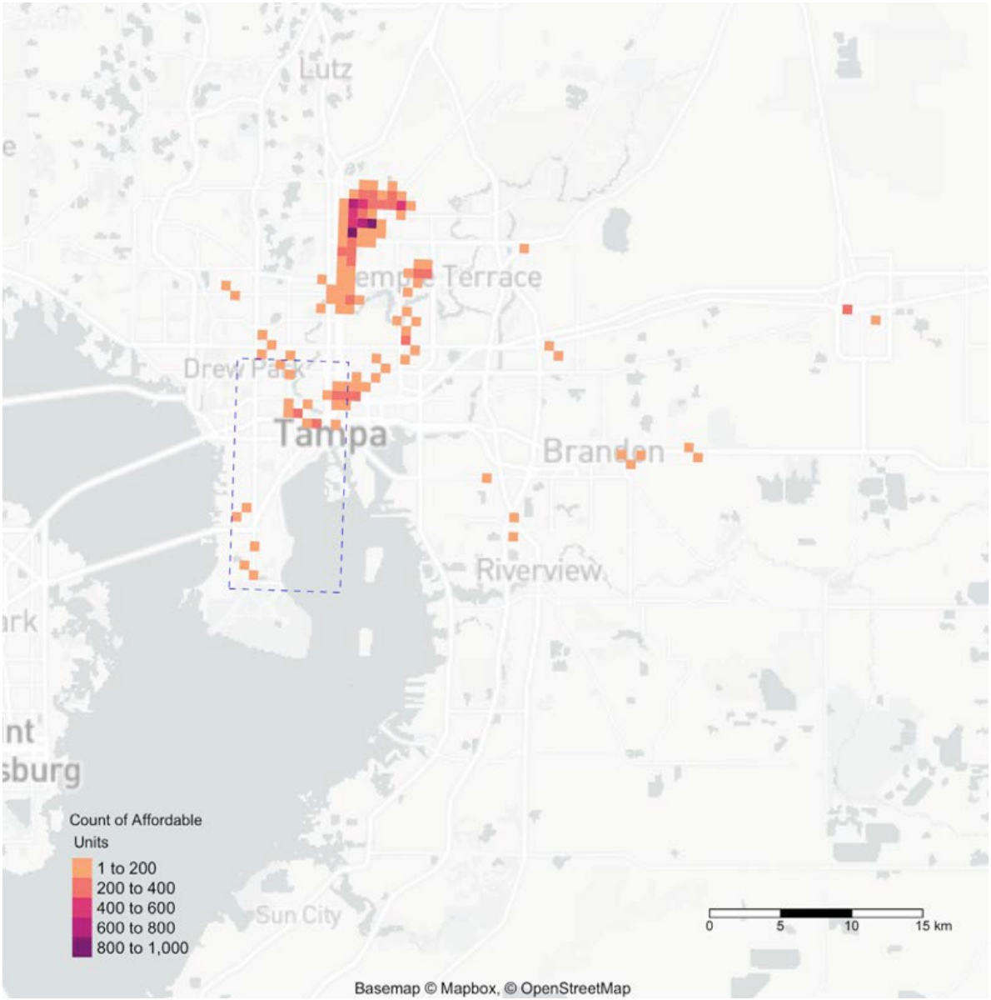

**Role:** Principal author, Gulf Research Program Science Policy Fellow (National Academies of Sciences) | **Dates:** September 2021 – August 2022

## Overview

The Tampa Bay Regional Planning Council's REACH program (Resilience and Energy Assessment of Communities and Housing) studies how climate hazards affect the region's affordable housing. It was funded by the JPMorgan Chase Foundation. As a policy fellow at the Council, I was the principal author of the program's report, *Affordable Housing and Flood Risk Throughout the Region: A Density Analysis of Flood Risk and Social Vulnerability*. The first version was released in June 2022 and an update followed in January 2023.

## What the report covers

The analysis covers 7 counties and 24 municipalities in the Tampa Bay Regional Resiliency Coalition. It looks at subsidized multi-family housing and non-subsidized affordable housing, including apartments, single-family homes, and mobile homes.

| Hazard type | Scenarios |
|---|---|
| FEMA flood zones | 1% annual chance (100-year), 0.2% annual chance (500-year) |
| Hurricane storm surge | Category 3, Category 5 |
| NOAA sea-level rise, 2070 (intermediate-high, 2.59 ft) | With and without a 10-year storm |

## Key findings

- Of the region's 480 assisted (subsidized) housing properties, 103 (21%) sit in the 1% annual flood zone and 131 (27%) in the 0.2% zone.
- Storm surge reaches further. 150 assisted properties are exposed to Category 3 surge, rising to 257, more than half of the region's stock, under Category 5.
- Exposure is clustered, not spread evenly. In Manatee County, 75% of affordable housing sits in hot spots. Hillsborough's affordable housing is the most dispersed, with about a quarter in hot spots.
- The report recommends directing new affordable housing away from high-hazard areas, while keeping it close to jobs and transit so relocation doesn't raise costs for low-income families.

## My contributions

- Wrote the report as principal author.
- Ran the hot spot analysis in R. It uses the Getis-Ord Gi* statistic to find where affordable housing clusters inside flood hazard areas.
- Built social vulnerability measures beyond flood risk, such as concentrations of elderly and low-income residents.
- Supported community organizations on related initiatives and studies through the Council.

## Impact

The report gave local governments in the region a shared picture of where flood risk and housing need overlap. It was presented at the 2022 REACH conference and informed local resilience and housing priorities.
